# Extraction benchmark: figures and tables

> **Mock shells.** Every figure and table marked MOCK is drawn from mock predictions (`llm_calc/extraction/mock.py`): gold labels corrupted at *assumed* accuracies, then graded by the real evaluator. They show what each experiment will produce and how it will be read. They are not results and must not be cited. Items marked REAL use data that already exists.

Regenerate: `python -m llm_calc.extraction mock-results --out <dir>` then `python -m llm_calc.extraction figures --eval-dir <dir> --out docs/mock_results --mock`. The same `figures` command renders the real page from the Killarney evaluation directory (without `--mock`).

## Design

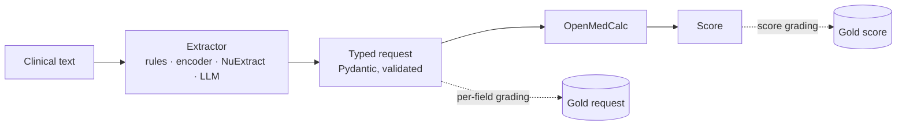

Figure 1. Every system fills the same typed request; the calculator is deterministic, so all errors are extraction errors.

## Data

### Figure 2. Where the test cases come from (REAL)

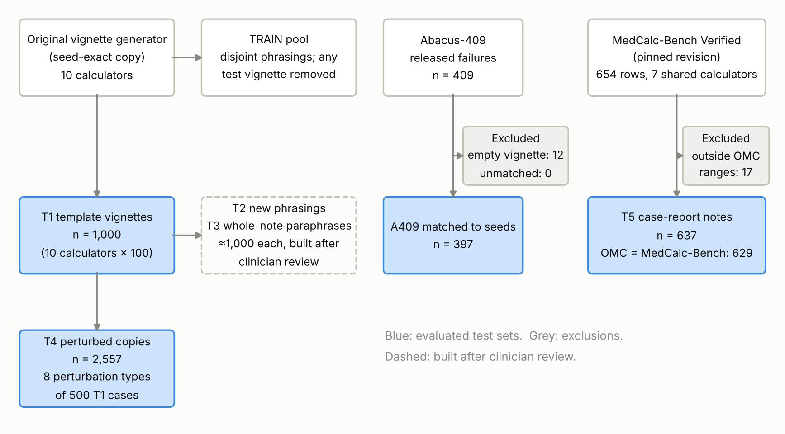

Counts are read from the committed datasets and build reports. T5 is rebuilt locally from MedCalc-Bench Verified (CC-BY-SA) and not redistributed; `MANIFEST.tsv` holds the SHA-256 of every set so a rebuild can be checked byte for byte. Source data: `source_data/flow.tsv`.

### Table 1. Test sets (REAL)

| set | cases | calculators | field instances | undocumented | HAS-BLED raw-facts (R) |
|---|---|---|---|---|---|
| T1 | 1000 | 10 | 13600 | 0.0% | 100 |
| A409 | 397 | 10 | 5566 | 0.0% | 30 |
| T4 | 2557 | 10 | 34825 | 0.7% | 350 |
| T5 | 637 | 7 | 10033 | 20.6% | 0 |
| T2 | ≈1,000 (planned) | 10 | — | — | ≈100 |
| T3 | ≈1,000 (planned) | 10 | — | — | ≈100 |

T5 is built locally from MedCalc-Bench Verified (CC-BY-SA) and is not committed. T2/T3 sizes are targets until clinician review is complete.

### Table 2. Systems under comparison (REAL)

| system | family | deployment | Killarney resources |
|---|---|---|---|
| rules | Rules | on-prem CPU | CPU |
| Bio_ClinicalBERT | Encoder | on-prem GPU | 1 × L40S |
| BiomedBERT | Encoder | on-prem GPU | 1 × L40S |
| gatortron-base | Encoder | on-prem GPU | 1 × L40S |
| ModernBERT-base | Encoder | on-prem GPU | 1 × L40S |
| NuExtract-2.0-2B | NuExtract | on-prem GPU | 1 × L40S |
| NuExtract-2.0-8B | NuExtract | on-prem GPU | 1 × L40S |
| NuExtract-2.0-8B (3-shot) | NuExtract | on-prem GPU | 1 × L40S |
| NuExtract3 | NuExtract | on-prem GPU | 1 × L40S |
| NuExtract3 (3-shot) | NuExtract | on-prem GPU | 1 × L40S |
| NuExtract3 (constrained) | NuExtract | on-prem GPU | 1 × L40S |
| Llama-3.1-8B | Open LLM | on-prem GPU | 1 × L40S |
| Qwen2.5-7B | Open LLM | on-prem GPU | 1 × L40S |
| Qwen3-8B | Open LLM | on-prem GPU | 1 × L40S |
| Qwen3-32B | Open LLM | on-prem GPU | 2 × L40S |
| Llama-3.1-70B | Open LLM | on-prem GPU | 4 × L40S |
| Llama-3.1-70B (3-shot) | Open LLM | on-prem GPU | 4 × L40S |
| Qwen2.5-72B | Open LLM | on-prem GPU | 4 × L40S |
| gpt-4o | API LLM | external API | external API |
| Jev 1.14 | System One | external API |  |
| Jev 1.13 | System One | external API |  |
| clinician:A | Clinician | human |  |
| clinician:B | Clinician | human |  |

From `cluster/killarney/models.tsv`. Encoders are fine-tuned on TRAIN; all LLM rows use JSON-schema constrained decoding unless marked otherwise.

### Table 3. Precision and minimum detectable differences (REAL)

| comparison set | cases | ±95% CI at 90% accuracy | MDE, 5% discordant | MDE, 10% discordant | MDE, 20% discordant | MDE, 10% discordant, Holm worst case (α=0.05/15) |
|---|---|---|---|---|---|---|
| T2 ∪ T3 (primary) | 2000 | 0.013 | 0.014 | 0.020 | 0.028 | 0.027 |
| one test set | 1000 | 0.019 | 0.020 | 0.028 | 0.040 | 0.038 |
| T5 (MedCalc-Bench, 7 calculators) | 637 | 0.023 | 0.025 | 0.035 | 0.050 | 0.047 |
| one calculator in T2 ∪ T3 | 200 | 0.042 | 0.044 | 0.062 | 0.088 | 0.084 |

Plan §9. CI half-width for an accuracy of 90% assuming independent cases (clustering widens it; T2 and T3 cases are independent of each other). MDE = smallest paired difference in final-score accuracy detected with 80% power by the two-sided McNemar test (Connor 1987), for a given share of cases on which two systems disagree; the last column applies the most stringent Holm step for the 15 between-family comparisons. Per-calculator results are descriptive.

## Primary endpoints

### Figure 3. Final-score accuracy by system and test set (MOCK)

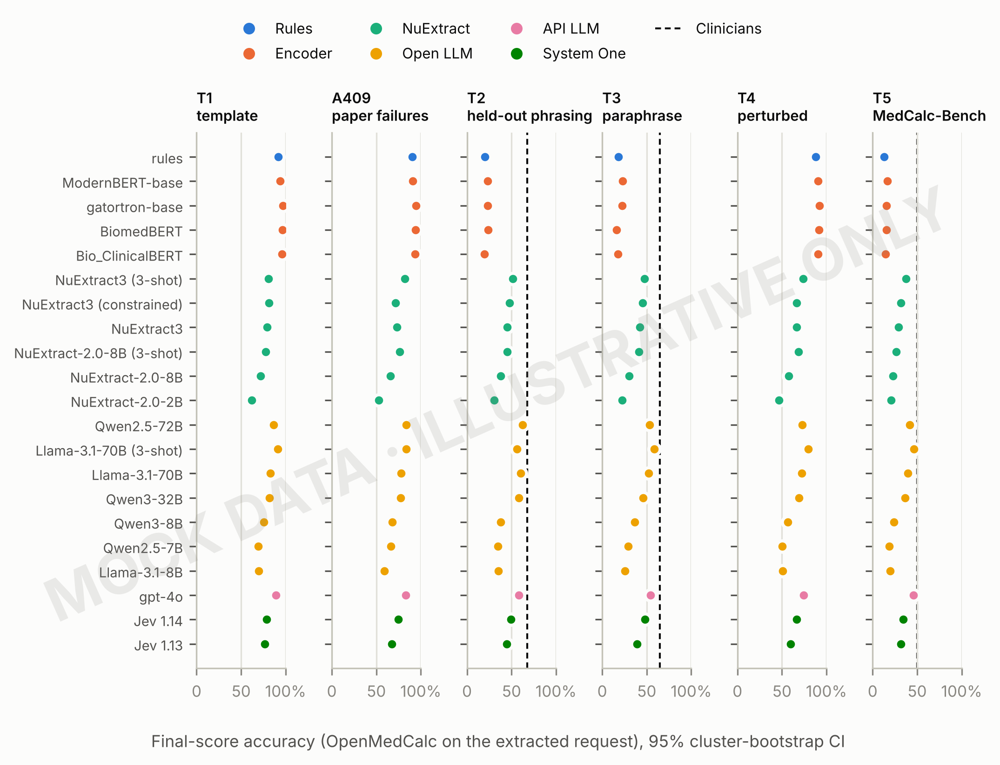

Primary endpoint 1 (plan §8.1). Rows are grouped by system family and sorted by accuracy on the primary sets (T2 ∪ T3). T1 and A409 are reported for comparability only (plan §5.3). Intervals resample whole base cases (2,000 resamples), so perturbed and paraphrased copies of a case move together. Dashed line: the two clinicians' pooled accuracy on their stratified sample of that set (Table 6). Table 4 is the table view. Source data: `source_data/headline.tsv`.

### Table 4. Primary endpoints (MOCK)

| system | family | n (T2∪T3) | T2∪T3 score | T2∪T3 macro field | T1 score | T4 score | T5 score | valid |
|---|---|---|---|---|---|---|---|---|
| rules | Rules | 800 | 0.190 (0.164 to 0.216) | 0.656 (0.639 to 0.673) | 0.920 (0.892 to 0.945) | 0.879 (0.857 to 0.900) | 0.131 (0.106 to 0.156) | 0.868 |
| ModernBERT-base | Encoder | 800 | 0.229 (0.200 to 0.259) | 0.729 (0.711 to 0.747) | 0.938 (0.912 to 0.963) | 0.907 (0.891 to 0.924) | 0.163 (0.135 to 0.192) | 0.900 |
| gatortron-base | Encoder | 800 | 0.228 (0.200 to 0.256) | 0.715 (0.697 to 0.733) | 0.968 (0.950 to 0.983) | 0.921 (0.902 to 0.939) | 0.158 (0.131 to 0.186) | 0.884 |
| BiomedBERT | Encoder | 800 | 0.201 (0.172 to 0.229) | 0.701 (0.684 to 0.719) | 0.963 (0.943 to 0.980) | 0.917 (0.899 to 0.933) | 0.156 (0.125 to 0.188) | 0.897 |
| Bio_ClinicalBERT | Encoder | 800 | 0.186 (0.160 to 0.214) | 0.676 (0.657 to 0.693) | 0.958 (0.938 to 0.978) | 0.906 (0.886 to 0.925) | 0.147 (0.120 to 0.174) | 0.873 |
| NuExtract3 (3-shot) | NuExtract | 800 | 0.492 (0.457 to 0.529) | 0.898 (0.885 to 0.912) | 0.807 (0.770 to 0.845) | 0.738 (0.702 to 0.772) | 0.373 (0.335 to 0.412) | 0.961 |
| NuExtract3 (constrained) | NuExtract | 800 | 0.466 (0.432 to 0.501) | 0.875 (0.860 to 0.889) | 0.812 (0.772 to 0.850) | 0.663 (0.626 to 0.699) | 0.318 (0.282 to 0.355) | 0.951 |
| NuExtract3 | NuExtract | 800 | 0.436 (0.401 to 0.471) | 0.864 (0.849 to 0.878) | 0.792 (0.752 to 0.833) | 0.663 (0.629 to 0.698) | 0.291 (0.257 to 0.326) | 0.946 |
| NuExtract-2.0-8B (3-shot) | NuExtract | 800 | 0.430 (0.394 to 0.465) | 0.855 (0.838 to 0.870) | 0.775 (0.733 to 0.812) | 0.687 (0.652 to 0.720) | 0.264 (0.231 to 0.299) | 0.941 |
| NuExtract-2.0-8B | NuExtract | 800 | 0.339 (0.306 to 0.371) | 0.801 (0.782 to 0.818) | 0.720 (0.677 to 0.763) | 0.579 (0.543 to 0.617) | 0.230 (0.199 to 0.261) | 0.910 |
| NuExtract-2.0-2B | NuExtract | 800 | 0.264 (0.233 to 0.294) | 0.743 (0.723 to 0.762) | 0.620 (0.573 to 0.667) | 0.465 (0.429 to 0.502) | 0.206 (0.176 to 0.238) | 0.890 |
| Qwen2.5-72B | Open LLM | 800 | 0.576 (0.540 to 0.610) | 0.911 (0.898 to 0.924) | 0.865 (0.833 to 0.897) | 0.731 (0.700 to 0.763) | 0.415 (0.380 to 0.450) | 0.966 |
| Llama-3.1-70B (3-shot) | Open LLM | 800 | 0.573 (0.539 to 0.605) | 0.919 (0.907 to 0.931) | 0.910 (0.880 to 0.938) | 0.798 (0.769 to 0.826) | 0.465 (0.425 to 0.507) | 0.969 |
| Llama-3.1-70B | Open LLM | 800 | 0.564 (0.530 to 0.599) | 0.903 (0.891 to 0.916) | 0.830 (0.792 to 0.868) | 0.725 (0.691 to 0.759) | 0.397 (0.355 to 0.439) | 0.965 |
| Qwen3-32B | Open LLM | 800 | 0.520 (0.486 to 0.555) | 0.890 (0.876 to 0.903) | 0.820 (0.782 to 0.855) | 0.690 (0.657 to 0.720) | 0.363 (0.326 to 0.401) | 0.961 |
| Qwen3-8B | Open LLM | 800 | 0.372 (0.338 to 0.404) | 0.844 (0.829 to 0.857) | 0.755 (0.713 to 0.797) | 0.568 (0.533 to 0.603) | 0.239 (0.201 to 0.277) | 0.953 |
| Qwen2.5-7B | Open LLM | 800 | 0.320 (0.290 to 0.354) | 0.808 (0.793 to 0.824) | 0.693 (0.645 to 0.738) | 0.502 (0.467 to 0.539) | 0.189 (0.158 to 0.223) | 0.930 |
| Llama-3.1-8B | Open LLM | 800 | 0.304 (0.274 to 0.335) | 0.795 (0.778 to 0.811) | 0.698 (0.652 to 0.743) | 0.509 (0.472 to 0.549) | 0.199 (0.167 to 0.232) | 0.927 |
| gpt-4o | API LLM | 800 | 0.562 (0.527 to 0.598) | 0.920 (0.908 to 0.931) | 0.892 (0.863 to 0.922) | 0.746 (0.714 to 0.776) | 0.456 (0.417 to 0.496) | 0.974 |
| Jev 1.14 | System One | 800 | 0.487 (0.452 to 0.521) | 0.891 (0.878 to 0.904) | 0.787 (0.748 to 0.828) | 0.665 (0.633 to 0.698) | 0.345 (0.313 to 0.380) | 0.963 |
| Jev 1.13 | System One | 800 | 0.417 (0.383 to 0.454) | 0.857 (0.841 to 0.871) | 0.765 (0.723 to 0.805) | 0.596 (0.559 to 0.633) | 0.318 (0.284 to 0.348) | 0.949 |

Estimate (95% CI). Score = final-score accuracy, OpenMedCalc on the extracted request. Macro field = per-field accuracy averaged within calculator, then across calculators. CIs are percentile intervals from 2,000 cluster-bootstrap resamples of base cases. Valid = schema-valid outputs.

### Figure 4. Generalisation gap: template text vs new wording (MOCK)

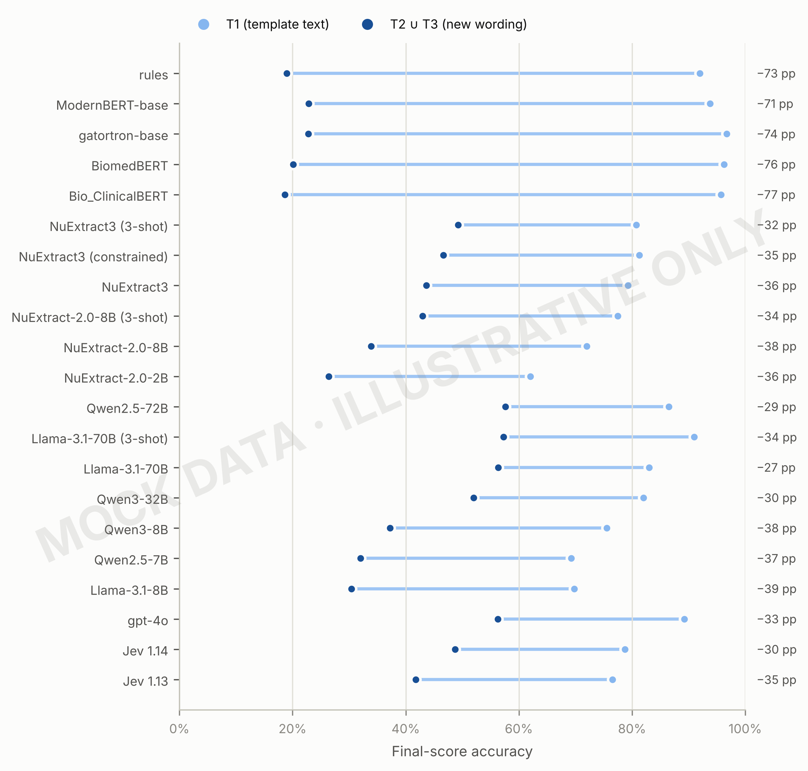

H1/H2 (plan §3). The label is the drop in percentage points from T1 to the primary sets. Systems that memorise phrasings (rules written on T1, fine-tuned encoders) are expected to show the largest drops.

### Table 5. Pairwise comparisons of the best system per family (MOCK)

| comparison | systems | n | only first right | only second right | Δ score accuracy (95% CI) | Δ macro field (95% CI) | p (exact McNemar) | p (Holm) |
|---|---|---|---|---|---|---|---|---|
| Rules vs Encoder | rules vs ModernBERT-base | 800 | 100 | 131 | -0.039 (-0.075 to -0.003) | -0.073 (-0.097 to -0.048) | 0.048 | 0.144 |
| Rules vs NuExtract | rules vs NuExtract3 (3-shot) | 800 | 68 | 310 | -0.302 (-0.347 to -0.260) | -0.242 (-0.264 to -0.219) | <0.001 | <0.001 |
| Rules vs Open LLM | rules vs Qwen2.5-72B | 800 | 53 | 362 | -0.386 (-0.427 to -0.346) | -0.255 (-0.277 to -0.232) | <0.001 | <0.001 |
| Rules vs API LLM | rules vs gpt-4o | 800 | 51 | 349 | -0.372 (-0.414 to -0.334) | -0.264 (-0.285 to -0.243) | <0.001 | <0.001 |
| Rules vs System One | rules vs Jev 1.14 | 800 | 63 | 301 | -0.297 (-0.340 to -0.255) | -0.235 (-0.257 to -0.213) | <0.001 | <0.001 |
| Encoder vs NuExtract | ModernBERT-base vs NuExtract3 (3-shot) | 800 | 71 | 282 | -0.264 (-0.307 to -0.221) | -0.169 (-0.192 to -0.146) | <0.001 | <0.001 |
| Encoder vs Open LLM | ModernBERT-base vs Qwen2.5-72B | 800 | 58 | 336 | -0.347 (-0.389 to -0.305) | -0.182 (-0.204 to -0.159) | <0.001 | <0.001 |
| Encoder vs API LLM | ModernBERT-base vs gpt-4o | 800 | 63 | 330 | -0.334 (-0.375 to -0.291) | -0.191 (-0.212 to -0.170) | <0.001 | <0.001 |
| Encoder vs System One | ModernBERT-base vs Jev 1.14 | 800 | 69 | 276 | -0.259 (-0.300 to -0.217) | -0.162 (-0.185 to -0.140) | <0.001 | <0.001 |
| NuExtract vs Open LLM | NuExtract3 (3-shot) vs Qwen2.5-72B | 800 | 142 | 209 | -0.084 (-0.128 to -0.037) | -0.013 (-0.031 to 0.006) | <0.001 | 0.002 |
| NuExtract vs API LLM | NuExtract3 (3-shot) vs gpt-4o | 800 | 153 | 209 | -0.070 (-0.115 to -0.021) | -0.022 (-0.039 to -0.006) | 0.004 | 0.015 |
| NuExtract vs System One | NuExtract3 (3-shot) vs Jev 1.14 | 800 | 166 | 162 | 0.005 (-0.039 to 0.050) | 0.007 (-0.012 to 0.025) | 0.868 | 1.000 |
| Open LLM vs API LLM | Qwen2.5-72B vs gpt-4o | 800 | 162 | 151 | 0.014 (-0.029 to 0.056) | -0.009 (-0.026 to 0.007) | 0.572 | 1.000 |
| Open LLM vs System One | Qwen2.5-72B vs Jev 1.14 | 800 | 207 | 136 | 0.089 (0.045 to 0.133) | 0.020 (0.002 to 0.036) | <0.001 | 0.001 |
| API LLM vs System One | gpt-4o vs Jev 1.14 | 800 | 202 | 142 | 0.075 (0.030 to 0.120) | 0.029 (0.011 to 0.046) | 0.001 | 0.007 |

Comparison family (i) of plan §9, on T2 ∪ T3, paired by case. Δ = first − second. Score-accuracy differences are tested with the exact McNemar test, Holm-adjusted within the family; CIs for both differences come from the paired cluster bootstrap. Figure 5 plots the differences.

### Figure 5. Paired differences between the best system of each family (T2 ∪ T3) (MOCK)

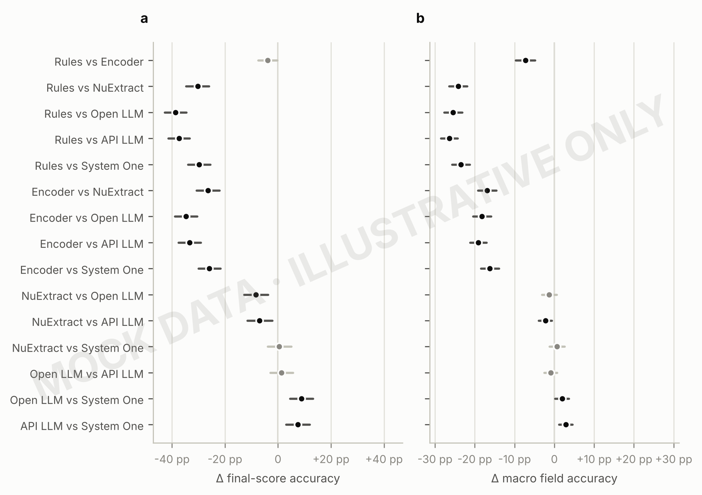

Points right of zero favour the first-named family. 95% paired cluster-bootstrap CIs. Dark marks: (a) score-accuracy differences significant after Holm adjustment; (b) macro field-accuracy differences whose CI excludes zero. Table view: Table 5. Source data: `source_data/forest.tsv`.

### Table 6. Systems against the clinician reference (MOCK)

| family | system | n | system accuracy | clinicians (mean of readers) | Δ system − clinicians (95% CI) | p vs A (McNemar) | p vs B (McNemar) |
|---|---|---|---|---|---|---|---|
| Rules | rules | 270 | 0.152 | 0.620 | -0.469 (-0.525 to -0.409) | <0.001 | <0.001 |
| Encoder | ModernBERT-base | 270 | 0.193 | 0.620 | -0.428 (-0.485 to -0.369) | <0.001 | <0.001 |
| NuExtract | NuExtract3 (3-shot) | 270 | 0.459 | 0.620 | -0.161 (-0.236 to -0.088) | <0.001 | 0.009 |
| Open LLM | Qwen2.5-72B | 270 | 0.578 | 0.620 | -0.043 (-0.110 to 0.021) | 0.304 | 0.714 |
| API LLM | gpt-4o | 270 | 0.533 | 0.620 | -0.087 (-0.152 to -0.017) | 0.017 | 0.304 |
| System One | Jev 1.14 | 270 | 0.433 | 0.620 | -0.187 (-0.251 to -0.121) | <0.001 | <0.001 |

Comparison family (iv): each family's best system against two clinicians who filled the same typed request blind to gold (270 cases, stratified by set and calculator; `clinician.py`). Δ uses the mean of the two readers per case, with a cluster-bootstrap CI; McNemar tests are against each reader, Holm-adjusted across the table. The readers agreed on the final score for 62.6% of cases; median time per case A 94 s, B 109 s.

## Where systems succeed and fail

### Figure 6. Field accuracy by system and calculator (MOCK)

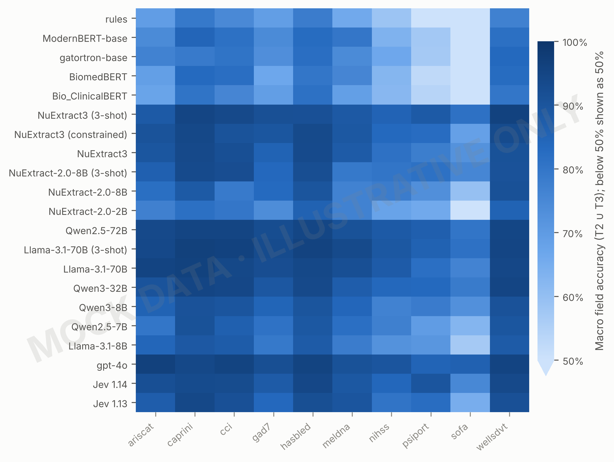

Primary endpoint 2 (plan §8.1), broken down by calculator. Scale starts at 50%. Table 7 gives the per-calculator numbers for the best system of each family.

### Table 7. Final-score accuracy by calculator (best system per family, T2 ∪ T3) (MOCK)

| calculator | n | Rules: rules | Encoder: ModernBERT-base | NuExtract: NuExtract3 (3-shot) | Open LLM: Qwen2.5-72B | API LLM: gpt-4o | System One: Jev 1.14 |
|---|---|---|---|---|---|---|---|
| ariscat | 80 | 0.175 | 0.325 | 0.600 | 0.750 | 0.775 | 0.675 |
| caprini | 80 | 0.000 | 0.037 | 0.175 | 0.300 | 0.300 | 0.175 |
| cci | 80 | 0.125 | 0.138 | 0.362 | 0.550 | 0.438 | 0.400 |
| gad7 | 80 | 0.175 | 0.212 | 0.575 | 0.600 | 0.537 | 0.487 |
| hasbled | 80 | 0.362 | 0.325 | 0.550 | 0.662 | 0.750 | 0.637 |
| meldna | 80 | 0.412 | 0.613 | 0.787 | 0.825 | 0.775 | 0.812 |
| nihss | 80 | 0.125 | 0.050 | 0.212 | 0.300 | 0.287 | 0.138 |
| psiport | 80 | 0.025 | 0.087 | 0.362 | 0.487 | 0.438 | 0.425 |
| sofa | 80 | 0.188 | 0.325 | 0.650 | 0.688 | 0.700 | 0.537 |
| wellsdvt | 80 | 0.312 | 0.175 | 0.650 | 0.600 | 0.625 | 0.588 |

Per-calculator n is about 200 per system, so these rows are descriptive (plan §9).

### Figure 7. Accuracy by field type (MOCK)

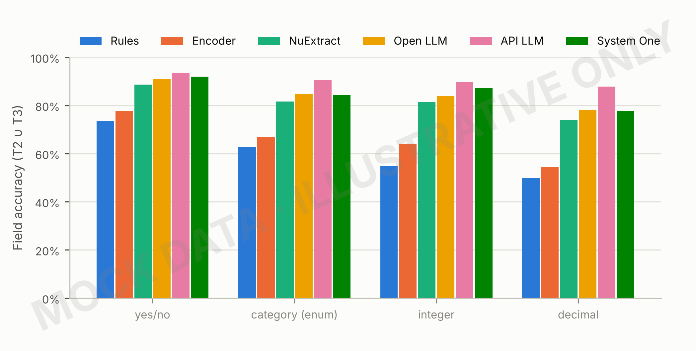

Secondary endpoint (plan §8.2). Enum fields include ordinal scales (NIHSS, GAD-7), where off-by-one readings are the expected error.

### Figure 8. Documented vs undocumented criteria (T5) (MOCK)

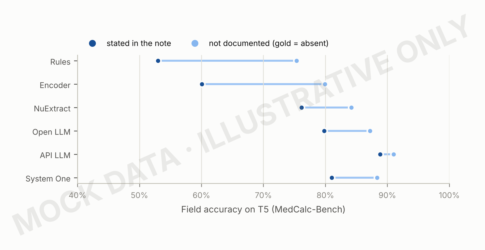

Plan §8.3. Undocumented criteria test whether a system invents findings (hallucinated presence). Axis starts at 40%.

### Table 8. Clinical agreement: risk bands, all-fields rate, score error (MOCK)

| system | score accuracy | risk-band agreement | all fields correct | mean |score error| |
|---|---|---|---|---|
| rules | 0.190 | 0.655 | 0.070 | 5.775 |
| ModernBERT-base | 0.229 | 0.720 | 0.121 | 4.826 |
| gatortron-base | 0.228 | 0.679 | 0.126 | 4.646 |
| BiomedBERT | 0.201 | 0.666 | 0.091 | 4.797 |
| Bio_ClinicalBERT | 0.186 | 0.677 | 0.089 | 4.991 |
| NuExtract3 (3-shot) | 0.492 | 0.853 | 0.429 | 2.481 |
| NuExtract3 (constrained) | 0.466 | 0.833 | 0.371 | 2.419 |
| NuExtract3 | 0.436 | 0.814 | 0.350 | 2.579 |
| NuExtract-2.0-8B (3-shot) | 0.430 | 0.806 | 0.338 | 2.716 |
| NuExtract-2.0-8B | 0.339 | 0.746 | 0.226 | 3.505 |
| NuExtract-2.0-2B | 0.264 | 0.706 | 0.146 | 4.140 |
| Qwen2.5-72B | 0.576 | 0.873 | 0.475 | 1.922 |
| Llama-3.1-70B (3-shot) | 0.573 | 0.876 | 0.512 | 2.031 |
| Llama-3.1-70B | 0.564 | 0.875 | 0.470 | 1.966 |
| Qwen3-32B | 0.520 | 0.841 | 0.419 | 2.231 |
| Qwen3-8B | 0.372 | 0.785 | 0.268 | 3.272 |
| Qwen2.5-7B | 0.320 | 0.769 | 0.195 | 3.495 |
| Llama-3.1-8B | 0.304 | 0.749 | 0.193 | 4.066 |
| gpt-4o | 0.562 | 0.870 | 0.491 | 1.902 |
| Jev 1.14 | 0.487 | 0.840 | 0.412 | 2.487 |
| Jev 1.13 | 0.417 | 0.809 | 0.311 | 3.043 |

Risk bands are provisional (`evaluate.RISK_BANDS`) until a clinician signs off the cut-offs. The gap between all-fields-correct and score accuracy measures how often errors cancel out.

### Table 9. Final-score accuracy by subgroup (best system per family) (MOCK)

| subgroup | level | n cases | Rules | Encoder | NuExtract | Open LLM | API LLM | System One |
|---|---|---|---|---|---|---|---|---|
| calculator type (T2∪T3) | criteria checklist | 480 | 0.17 (0.14 to 0.20) | 0.18 (0.15 to 0.22) | 0.45 (0.41 to 0.49) | 0.56 (0.51 to 0.60) | 0.55 (0.51 to 0.60) | 0.48 (0.44 to 0.53) |
| calculator type (T2∪T3) | questionnaire | 80 | 0.17 (0.09 to 0.26) | 0.21 (0.12 to 0.30) | 0.57 (0.46 to 0.69) | 0.60 (0.49 to 0.70) | 0.54 (0.42 to 0.65) | 0.49 (0.38 to 0.60) |
| calculator type (T2∪T3) | lab equation | 80 | 0.41 (0.31 to 0.53) | 0.61 (0.50 to 0.71) | 0.79 (0.70 to 0.86) | 0.82 (0.74 to 0.90) | 0.78 (0.69 to 0.86) | 0.81 (0.72 to 0.89) |
| calculator type (T2∪T3) | examination scale | 80 | 0.12 (0.06 to 0.21) | 0.05 (0.01 to 0.10) | 0.21 (0.12 to 0.30) | 0.30 (0.20 to 0.40) | 0.29 (0.20 to 0.40) | 0.14 (0.06 to 0.23) |
| calculator type (T2∪T3) | organ physiology | 80 | 0.19 (0.11 to 0.28) | 0.33 (0.23 to 0.42) | 0.65 (0.55 to 0.75) | 0.69 (0.59 to 0.79) | 0.70 (0.60 to 0.80) | 0.54 (0.42 to 0.64) |
| T5 note type | Extracted | 87 | 0.20 (0.11 to 0.29) | 0.24 (0.15 to 0.34) | 0.43 (0.32 to 0.53) | 0.36 (0.25 to 0.46) | 0.57 (0.47 to 0.68) | 0.44 (0.33 to 0.54) |
| T5 note type | Synthetic | 470 | 0.12 (0.09 to 0.15) | 0.15 (0.12 to 0.18) | 0.36 (0.32 to 0.41) | 0.43 (0.39 to 0.46) | 0.43 (0.39 to 0.48) | 0.33 (0.29 to 0.36) |
| T4 perturbation | abbreviations | 131 | 0.90 (0.85 to 0.95) | 0.90 (0.85 to 0.95) | 0.70 (0.63 to 0.78) | 0.66 (0.57 to 0.73) | 0.74 (0.66 to 0.82) | 0.65 (0.56 to 0.73) |
| T4 perturbation | conflicting | 60 | 0.88 (0.80 to 0.97) | 0.95 (0.88 to 1.00) | 0.73 (0.62 to 0.85) | 0.73 (0.62 to 0.85) | 0.75 (0.63 to 0.85) | 0.72 (0.62 to 0.83) |
| T4 perturbation | distractors | 181 | 0.90 (0.86 to 0.94) | 0.86 (0.81 to 0.91) | 0.70 (0.63 to 0.76) | 0.75 (0.69 to 0.81) | 0.78 (0.72 to 0.83) | 0.59 (0.51 to 0.66) |
| T4 perturbation | injection | 181 | 0.90 (0.85 to 0.94) | 0.91 (0.86 to 0.94) | 0.73 (0.67 to 0.79) | 0.75 (0.68 to 0.81) | 0.72 (0.66 to 0.79) | 0.69 (0.61 to 0.75) |
| T4 perturbation | long_note | 194 | 0.85 (0.80 to 0.90) | 0.92 (0.88 to 0.95) | 0.75 (0.70 to 0.81) | 0.70 (0.64 to 0.76) | 0.72 (0.65 to 0.78) | 0.66 (0.59 to 0.72) |
| T4 perturbation | omission | 94 | 0.88 (0.82 to 0.95) | 0.91 (0.85 to 0.97) | 0.81 (0.72 to 0.88) | 0.71 (0.62 to 0.80) | 0.82 (0.73 to 0.89) | 0.71 (0.62 to 0.80) |
| T4 perturbation | reorder | 100 | 0.83 (0.75 to 0.90) | 0.93 (0.88 to 0.97) | 0.65 (0.56 to 0.74) | 0.73 (0.64 to 0.81) | 0.63 (0.54 to 0.72) | 0.66 (0.56 to 0.75) |
| T4 perturbation | units | 80 | 0.89 (0.81 to 0.95) | 0.94 (0.89 to 0.99) | 0.90 (0.82 to 0.96) | 0.88 (0.80 to 0.94) | 0.85 (0.78 to 0.93) | 0.75 (0.65 to 0.84) |

Descriptive (plan §9.2): subgroup n is small, so differences between subgroups are not tested. Calculator type groups calculators by the kind of input they need. T5 note type separates MedCalc-Bench's synthetic notes from notes extracted from published case reports.

### Table 10. Sensitivity analyses (MOCK)

| family | system | S0 primary (score, T2∪T3) | S1 invalid outputs excluded | S2 without HAS-BLED and CCI | S3 macro field, exact floats | S4 T5, all rows | S5 T5, OMC agrees with MedCalc-Bench | family rank stable |
|---|---|---|---|---|---|---|---|---|
| Rules | rules | 0.190 | 0.219 | 0.177 | 0.656 | 0.131 | 0.129 | yes |
| Encoder | ModernBERT-base | 0.229 | 0.254 | 0.228 | 0.729 | 0.163 | 0.162 | yes |
| NuExtract | NuExtract3 (3-shot) | 0.492 | 0.512 | 0.502 | 0.898 | 0.373 | 0.370 | yes |
| Open LLM | Qwen2.5-72B | 0.576 | 0.596 | 0.569 | 0.911 | 0.415 | 0.410 | no |
| API LLM | gpt-4o | 0.562 | 0.578 | 0.555 | 0.920 | 0.456 | 0.454 | no |
| System One | Jev 1.14 | 0.487 | 0.506 | 0.480 | 0.891 | 0.345 | 0.342 | yes |

Pre-specified (plan §9.1). S0: primary endpoint. S1: invalid outputs dropped instead of counted wrong (favours systems that fail loudly). S2: calculators whose scoring has an open decision removed (HAS-BLED age ≥65 vs >65; CCI liver wording). S3: macro field accuracy with exact float match instead of ±1%. S4–S5: T5 with and without the rows where OpenMedCalc's score differs from MedCalc-Bench's answer. The last column says whether each family keeps its rank across all of them.

## Robustness, schema design and the original study

### Figure 9. Robustness to controlled perturbations (T4) (MOCK)

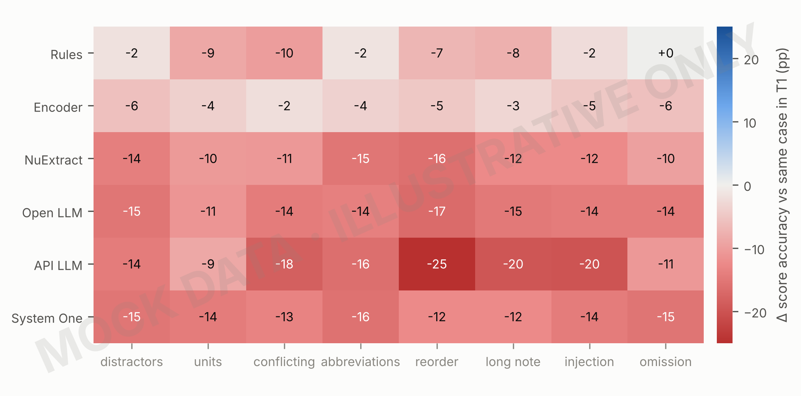

RQ4. Each cell is the paired change in final-score accuracy, T4 minus the same base case in T1, averaged over the systems in a family. Red is worse than on the original text.

### Figure 10. Decision vs raw-facts schema (HAS-BLED) (MOCK)

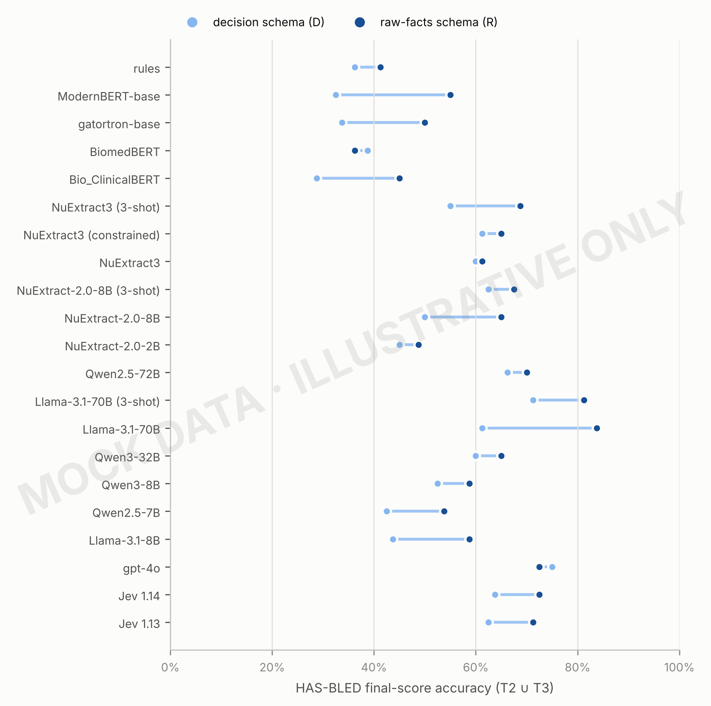

RQ3/H4. Same notes, two schemas: the extractor applies the thresholds (D) or the API does (R).

### Table 11. Raw-facts vs decision schema within each system (HAS-BLED) (MOCK)

| system | n | D | R | Δ R − D (95% CI) | p | p (Holm) |
|---|---|---|---|---|---|---|
| rules | 80 | 0.362 | 0.412 | 0.050 (-0.087 to 0.188) | 0.608 | 1.000 |
| ModernBERT-base | 80 | 0.325 | 0.550 | 0.225 (0.075 to 0.375) | 0.008 | 0.158 |
| gatortron-base | 80 | 0.338 | 0.500 | 0.163 (0.013 to 0.312) | 0.066 | 1.000 |
| BiomedBERT | 80 | 0.388 | 0.362 | -0.025 (-0.188 to 0.138) | 0.880 | 1.000 |
| Bio_ClinicalBERT | 80 | 0.287 | 0.450 | 0.163 (0.025 to 0.300) | 0.035 | 0.667 |
| NuExtract3 (3-shot) | 80 | 0.550 | 0.688 | 0.138 (-0.013 to 0.287) | 0.108 | 1.000 |
| NuExtract3 (constrained) | 80 | 0.613 | 0.650 | 0.037 (-0.125 to 0.188) | 0.749 | 1.000 |
| NuExtract3 | 80 | 0.600 | 0.613 | 0.013 (-0.125 to 0.150) | 1.000 | 1.000 |
| NuExtract-2.0-8B (3-shot) | 80 | 0.625 | 0.675 | 0.050 (-0.100 to 0.212) | 0.636 | 1.000 |
| NuExtract-2.0-8B | 80 | 0.500 | 0.650 | 0.150 (-0.000 to 0.300) | 0.081 | 1.000 |
| NuExtract-2.0-2B | 80 | 0.450 | 0.487 | 0.037 (-0.113 to 0.188) | 0.743 | 1.000 |
| Qwen2.5-72B | 80 | 0.662 | 0.700 | 0.037 (-0.113 to 0.188) | 0.749 | 1.000 |
| Llama-3.1-70B (3-shot) | 80 | 0.713 | 0.812 | 0.100 (-0.037 to 0.237) | 0.215 | 1.000 |
| Llama-3.1-70B | 80 | 0.613 | 0.838 | 0.225 (0.087 to 0.362) | 0.005 | 0.107 |
| Qwen3-32B | 80 | 0.600 | 0.650 | 0.050 (-0.100 to 0.200) | 0.627 | 1.000 |
| Qwen3-8B | 80 | 0.525 | 0.588 | 0.062 (-0.087 to 0.212) | 0.511 | 1.000 |
| Qwen2.5-7B | 80 | 0.425 | 0.537 | 0.113 (-0.037 to 0.275) | 0.211 | 1.000 |
| Llama-3.1-8B | 80 | 0.438 | 0.588 | 0.150 (-0.025 to 0.312) | 0.111 | 1.000 |
| gpt-4o | 80 | 0.750 | 0.725 | -0.025 (-0.163 to 0.125) | 0.864 | 1.000 |
| Jev 1.14 | 80 | 0.637 | 0.725 | 0.087 (-0.062 to 0.250) | 0.349 | 1.000 |
| Jev 1.13 | 80 | 0.625 | 0.713 | 0.087 (-0.050 to 0.237) | 0.311 | 1.000 |

Comparison family (ii) of plan §9 (H4): final-score accuracy on the same T2 ∪ T3 HAS-BLED notes with each schema. Exact McNemar test, Holm-adjusted across systems; paired cluster-bootstrap CI.

### Figure 11. Extract-then-compute vs the paper's end-to-end arms (MOCK)

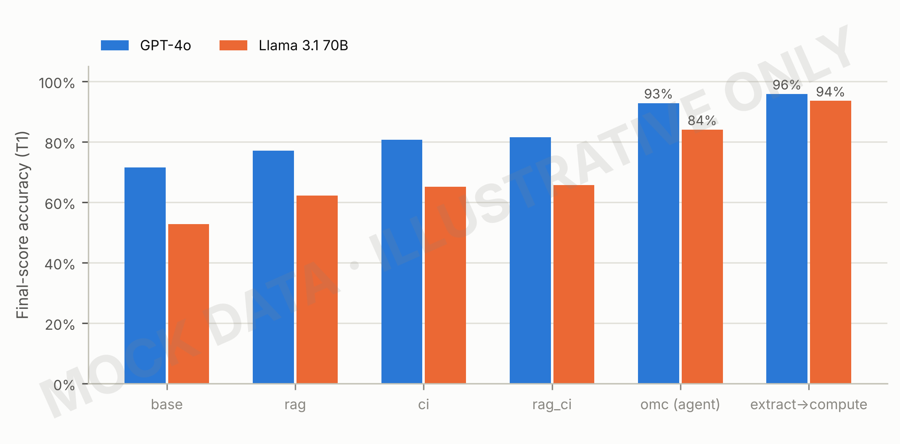

RQ2/H3. The first five arms are the original study's (re-run on the same T1 cases); the last is this benchmark's pipeline with the same model. Only T1 allows the original arms' parser to be reused.

### Table 12. Paper arms vs extract-then-compute (T1) (MOCK)

| arm | GPT-4o | Llama 3.1 70B |
|---|---|---|
| base | 0.715 | 0.527 |
| rag | 0.770 | 0.622 |
| ci | 0.806 | 0.651 |
| rag_ci | 0.815 | 0.657 |
| omc (agent) | 0.928 | 0.840 |
| extract→compute | 0.958 | 0.935 |

Table view of Figure 11.

## Errors, cost and the statistical model

### Figure 12. What kind of mistakes each family makes (MOCK)

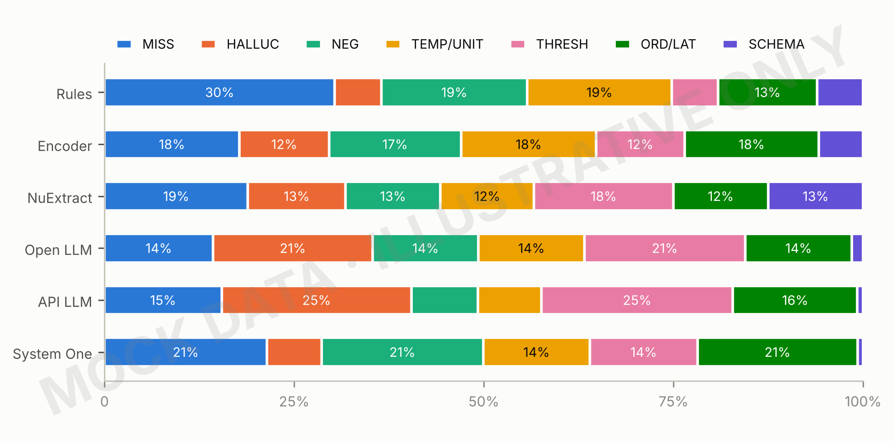

Plan §10. Share of annotated field errors by code: missed fact, hallucinated value, negation, time point or unit, threshold applied wrongly, ordinal or laterality slip, schema failure. Real values need the two-annotator error study.

### Table 13. Error codes by family (share of annotated field errors) (MOCK)

| family | MISS | HALLUC | NEG | TEMP/UNIT | THRESH | ORD/LAT | SCHEMA |
|---|---|---|---|---|---|---|---|
| Rules | 0.304 | 0.061 | 0.192 | 0.190 | 0.061 | 0.130 | 0.061 |
| Encoder | 0.178 | 0.118 | 0.174 | 0.178 | 0.116 | 0.177 | 0.059 |
| NuExtract | 0.189 | 0.129 | 0.125 | 0.123 | 0.184 | 0.125 | 0.125 |
| Open LLM | 0.143 | 0.210 | 0.140 | 0.140 | 0.212 | 0.140 | 0.015 |
| API LLM | 0.154 | 0.250 | 0.088 | 0.084 | 0.252 | 0.164 | 0.008 |
| System One | 0.214 | 0.072 | 0.213 | 0.140 | 0.142 | 0.211 | 0.007 |

Table view of Figure 12.

### Figure 13. Accuracy against speed and deployment (MOCK)

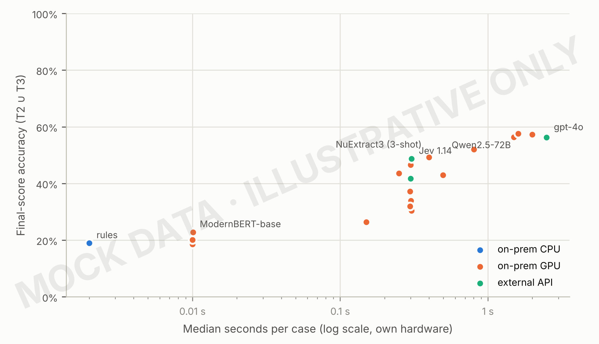

RQ5. Colour is where the system can run; this matters for patient data. The best system of each family is labelled. Table 14 adds GPU-hours.

### Table 14. Operational metrics (MOCK)

| system | median s/case | p95 s/case | deployment | GPU-hours per 1k cases |
|---|---|---|---|---|
| rules | 0.002 | 0.002 | on-prem CPU | — |
| ModernBERT-base | 0.010 | 0.012 | on-prem GPU | 0.003 |
| gatortron-base | 0.010 | 0.012 | on-prem GPU | 0.003 |
| BiomedBERT | 0.010 | 0.012 | on-prem GPU | 0.003 |
| Bio_ClinicalBERT | 0.010 | 0.012 | on-prem GPU | 0.003 |
| NuExtract3 (3-shot) | 0.400 | 0.472 | on-prem GPU | 0.111 |
| NuExtract3 (constrained) | 0.301 | 0.354 | on-prem GPU | 0.084 |
| NuExtract3 | 0.249 | 0.295 | on-prem GPU | 0.069 |
| NuExtract-2.0-8B (3-shot) | 0.500 | 0.591 | on-prem GPU | 0.139 |
| NuExtract-2.0-8B | 0.300 | 0.354 | on-prem GPU | 0.083 |
| NuExtract-2.0-2B | 0.150 | 0.177 | on-prem GPU | 0.042 |
| Qwen2.5-72B | 1.602 | 1.886 | on-prem GPU | 0.445 |
| Llama-3.1-70B (3-shot) | 1.998 | 2.362 | on-prem GPU | 0.555 |
| Llama-3.1-70B | 1.497 | 1.773 | on-prem GPU | 0.416 |
| Qwen3-32B | 0.804 | 0.944 | on-prem GPU | 0.223 |
| Qwen3-8B | 0.300 | 0.353 | on-prem GPU | 0.083 |
| Qwen2.5-7B | 0.299 | 0.353 | on-prem GPU | 0.083 |
| Llama-3.1-8B | 0.301 | 0.354 | on-prem GPU | 0.084 |
| gpt-4o | 2.492 | 2.947 | external API | — |
| Jev 1.14 | 0.301 | 0.354 | external API | — |
| Jev 1.13 | 0.299 | 0.354 | external API | — |

Plan §8.4. Real latency comes from `latency_s` in each prediction; GPU-hours scale it by the GPUs in `models.tsv`; API cost is added from the provider's invoice.

### Table 15. Field-level model: which factors change the odds of a correct field (MOCK)

| term | odds ratio (95% CI) | p |
|---|---|---|
| Intercept | 80.34 (41.27 to 156.39) | <0.001 |
| system: gpt-4o | 1.22 (0.57 to 2.62) | 0.603 |
| system: ModernBERT-base | 0.91 (0.36 to 2.29) | 0.835 |
| system: Jev 1.14 | 0.49 (0.23 to 1.05) | 0.067 |
| system: NuExtract3 (3-shot) | 0.42 (0.18 to 0.99) | 0.047 |
| system: Qwen2.5-72B | 0.55 (0.24 to 1.27) | 0.160 |
| set: T2 | 0.03 (0.02 to 0.06) | <0.001 |
| set: T3 | 0.03 (0.01 to 0.05) | <0.001 |
| set: T4 | 0.88 (0.42 to 1.86) | 0.745 |
| set: T5 | 0.02 (0.01 to 0.04) | <0.001 |
| field type: enum | 0.59 (0.56 to 0.62) | <0.001 |
| field type: float | 1.12 (1.07 to 1.16) | <0.001 |
| field type: int | 1.04 (1.01 to 1.07) | 0.017 |
| system: gpt-4o × set: T2 | 5.22 (2.26 to 12.02) | <0.001 |
| system: ModernBERT-base × set: T2 | 1.64 (0.64 to 4.24) | 0.307 |
| system: Jev 1.14 × set: T2 | 9.13 (4.06 to 20.50) | <0.001 |
| system: NuExtract3 (3-shot) × set: T2 | 11.15 (4.59 to 27.08) | <0.001 |
| system: Qwen2.5-72B × set: T2 | 10.91 (4.49 to 26.47) | <0.001 |
| system: gpt-4o × set: T3 | 5.27 (2.35 to 11.78) | <0.001 |
| system: ModernBERT-base × set: T3 | 1.56 (0.61 to 4.00) | 0.356 |
| system: Jev 1.14 × set: T3 | 10.78 (4.80 to 24.21) | <0.001 |
| system: NuExtract3 (3-shot) × set: T3 | 14.79 (6.08 to 35.98) | <0.001 |
| system: Qwen2.5-72B × set: T3 | 10.85 (4.52 to 26.01) | <0.001 |
| system: gpt-4o × set: T4 | 0.33 (0.14 to 0.79) | 0.013 |
| system: ModernBERT-base × set: T4 | 1.13 (0.36 to 3.55) | 0.829 |
| system: Jev 1.14 × set: T4 | 0.62 (0.26 to 1.47) | 0.277 |
| system: NuExtract3 (3-shot) × set: T4 | 0.83 (0.32 to 2.19) | 0.713 |
| system: Qwen2.5-72B × set: T4 | 0.92 (0.38 to 2.21) | 0.845 |
| system: gpt-4o × set: T5 | 5.83 (2.62 to 12.97) | <0.001 |
| system: ModernBERT-base × set: T5 | 1.64 (0.64 to 4.21) | 0.306 |
| system: Jev 1.14 × set: T5 | 8.70 (3.94 to 19.19) | <0.001 |
| system: NuExtract3 (3-shot) × set: T5 | 10.67 (4.47 to 25.46) | <0.001 |
| system: Qwen2.5-72B × set: T5 | 9.91 (4.15 to 23.67) | <0.001 |

Population-averaged logistic model (GEE, robust sandwich SEs clustered by base case; 231,984 field rows in 923 clusters): correct ~ system × test set + field type + calculator, best system per family, decision schema. Reference levels: rules, T1, boolean field; calculator effects are adjusted for but not shown. Interaction rows (system × set) say how much more (OR > 1) or less a system degrades on that set than the reference does; their joint test is in Table 16.

### Table 16. Joint Wald tests for the field-level model (MOCK)

| term | χ² | df | p | χ², exchangeable (S6) | p, exchangeable (S6) |
|---|---|---|---|---|---|
| system | 17.400 | 5 | 0.004 | 16.500 | 0.006 |
| set | 456.000 | 4 | <0.001 | 444.100 | <0.001 |
| field type | 447.900 | 3 | <0.001 | 436.600 | <0.001 |
| calculator | 1245.900 | 9 | <0.001 | 1145.700 | <0.001 |
| system × set | 324.500 | 20 | <0.001 | 320.600 | <0.001 |

The system × test set row is the pre-specified test of H1–H2: do systems differ in how much they lose from template text (T1) to new wording (T2, T3), perturbations (T4) and real notes (T5)? The last two columns refit the model with an exchangeable working correlation (sensitivity S6).

## Confidence and selective automation

### Figure 14. Using reported confidence to decide what to automate (MOCK)

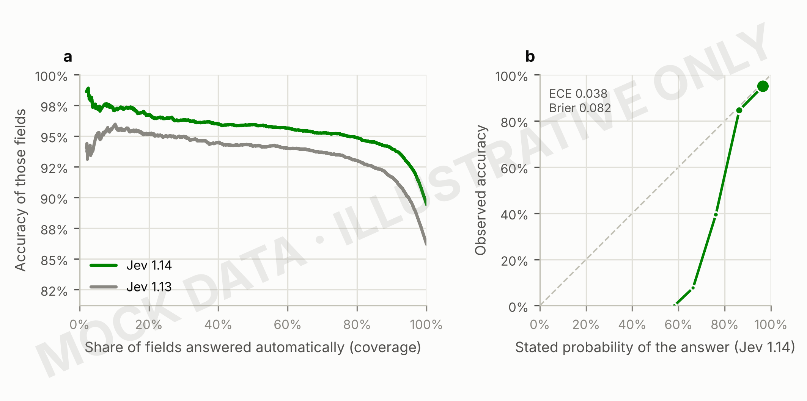

Systems that return a confidence per answer (Jev) can defer uncertain fields to a human. (a) accuracy of the fields kept as the least confident are deferred (risk-coverage; ranked by Jev's confidence statistic). (b) Reliability diagram of the probability Jev gave its chosen answer (10 equal-width bins, marker area ∝ fields; the dashed line is perfect calibration). Table 17 gives operating points and Table 18 the calibration metrics. Source data: `source_data/confidence.tsv`.

### Table 17. Confidence-gated operating points (MOCK)

| system | threshold | fields auto-accepted | accuracy of auto-accepted fields | cases fully automatic | score accuracy of those cases |
|---|---|---|---|---|---|
| Jev 1.14 | 0.500 | 0.946 | 0.928 | 0.519 | 0.716 |
| Jev 1.14 | 0.700 | 0.790 | 0.949 | 0.094 | 0.853 |
| Jev 1.14 | 0.800 | 0.605 | 0.956 | 0.011 | 0.889 |
| Jev 1.14 | 0.900 | 0.304 | 0.963 | 0.000 | — |
| Jev 1.13 | 0.500 | 0.934 | 0.905 | 0.430 | 0.651 |
| Jev 1.13 | 0.700 | 0.771 | 0.933 | 0.087 | 0.886 |
| Jev 1.13 | 0.800 | 0.582 | 0.941 | 0.009 | 1.000 |
| Jev 1.13 | 0.900 | 0.297 | 0.949 | 0.000 | — |

A case is fully automatic when every field's confidence clears the threshold; the rest go to review. The clinical question is which threshold gives acceptable score accuracy at useful coverage.

### Table 18. Calibration and discrimination of reported confidence (MOCK)

| system | fields | n | accuracy | mean stated probability | Brier (95% CI) | ECE (95% CI) | AUROC | AURC |
|---|---|---|---|---|---|---|---|---|
| Jev 1.14 | all fields | 10880 | 0.894 | 0.933 | 0.082 (0.071 to 0.094) | 0.038 (0.027 to 0.052) | 0.787 | 0.044 |
| Jev 1.14 | bool | 5600 | 0.927 | 0.935 | 0.056 (0.047 to 0.068) | 0.031 (0.024 to 0.040) | 0.827 | 0.024 |
| Jev 1.14 | enum | 2480 | 0.863 | 0.925 | 0.098 (0.089 to 0.107) | 0.061 (0.050 to 0.074) | 0.860 | 0.038 |
| Jev 1.14 | float | 1360 | 0.814 | 0.933 | 0.153 (0.110 to 0.197) | 0.119 (0.069 to 0.169) | 0.661 | 0.132 |
| Jev 1.14 | int | 1440 | 0.897 | 0.937 | 0.084 (0.060 to 0.112) | 0.040 (0.021 to 0.072) | 0.718 | 0.055 |
| Jev 1.13 | all fields | 10880 | 0.862 | 0.929 | 0.105 (0.092 to 0.119) | 0.067 (0.052 to 0.083) | 0.780 | 0.063 |
| Jev 1.13 | bool | 5600 | 0.912 | 0.932 | 0.068 (0.060 to 0.077) | 0.025 (0.022 to 0.035) | 0.808 | 0.034 |
| Jev 1.13 | enum | 2480 | 0.824 | 0.918 | 0.121 (0.111 to 0.131) | 0.094 (0.082 to 0.108) | 0.898 | 0.042 |
| Jev 1.13 | float | 1360 | 0.742 | 0.931 | 0.210 (0.161 to 0.260) | 0.189 (0.134 to 0.246) | 0.675 | 0.187 |
| Jev 1.13 | int | 1440 | 0.848 | 0.931 | 0.124 (0.093 to 0.158) | 0.083 (0.049 to 0.123) | 0.671 | 0.100 |

Plan §8.5 (H5). Brier score and expected calibration error (ECE, 10 equal-width bins) of the probability the system gave its chosen answer, with cluster-bootstrap CIs; AUROC = how well confidence separates right from wrong answers; AURC = area under the risk-coverage curve (lower is better). Mean stated probability above accuracy means overconfidence.

## Real results already available

### Figure 15. Can a final-score error be traced to one field? (REAL)

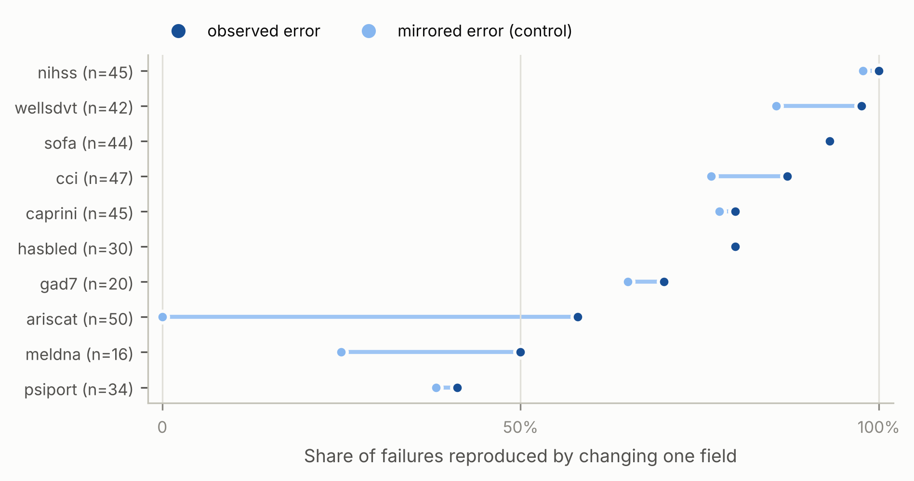

Real data: the 373 Abacus-409 failures with a numeric answer. Where the control is as high as the observed share (additive scores), a one-field explanation is no evidence of which field was misread.

### Figure 16. CPU baselines across test sets (REAL)

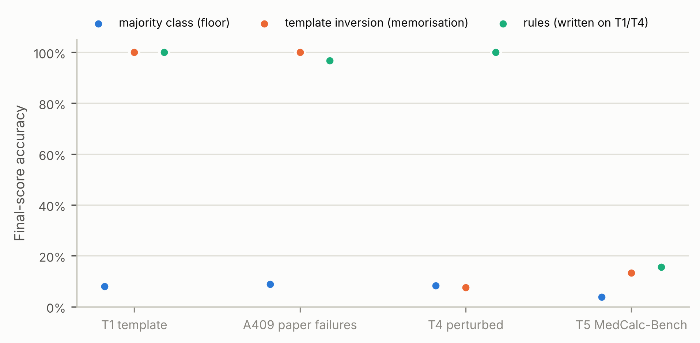

Real data. Perfect scores on template text (T1, A409) fall to the floor once the wording is new: the reason T2, T3 and T5 are primary.
