# Extraction benchmark: figures and tables

> **Mock shells.** Every figure and table marked MOCK is drawn from mock predictions (`llm_calc/extraction/mock.py`): gold labels corrupted at *assumed* accuracies, then graded by the real evaluator. They show what each experiment will produce and how it will be read. They are not results and must not be cited. Items marked REAL use data that already exists.

Regenerate: `python -m llm_calc.extraction mock-results --out <dir>` then `python -m llm_calc.extraction figures --eval-dir <dir> --out docs/mock_results --mock`. The same `figures` command renders the real page from the Killarney evaluation directory (without `--mock`).

## Design

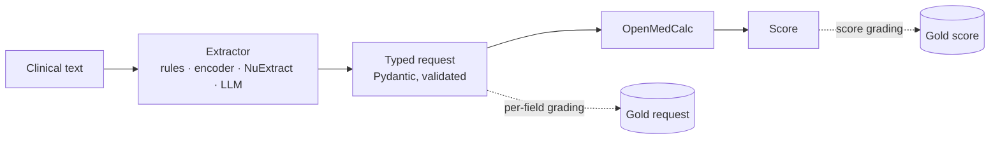

Figure 1. Every system fills the same typed request; the calculator is deterministic, so all errors are extraction errors.

## Data

### Table 1. Test sets (REAL)

| set | cases | calculators | field instances | undocumented | HAS-BLED raw-facts (R) |
|---|---|---|---|---|---|
| T1 | 1000 | 10 | 13600 | 0.0% | 100 |
| A409 | 397 | 10 | 5566 | 0.0% | 30 |
| T4 | 1869 | 10 | 25501 | 0.0% | 250 |
| T5 | 637 | 7 | 10033 | 20.6% | 0 |
| T2 | ≈1,000 (planned) | 10 | — | — | ≈100 |
| T3 | ≈1,000 (planned) | 10 | — | — | ≈100 |

T5 is built locally from MedCalc-Bench Verified (CC-BY-SA) and is not committed. T2/T3 sizes are targets until clinician review is complete.

### Table 2. Systems under comparison (REAL)

| system | family | deployment | Killarney resources |
|---|---|---|---|
| rules | Rules | on-prem CPU | CPU |
| Bio_ClinicalBERT | Encoder | on-prem GPU | 1 × L40S |
| BiomedBERT | Encoder | on-prem GPU | 1 × L40S |
| gatortron-base | Encoder | on-prem GPU | 1 × L40S |
| ModernBERT-base | Encoder | on-prem GPU | 1 × L40S |
| NuExtract-2.0-2B | NuExtract | on-prem GPU | 1 × L40S |
| NuExtract-2.0-8B | NuExtract | on-prem GPU | 1 × L40S |
| NuExtract-2.0-8B (3-shot) | NuExtract | on-prem GPU | 1 × L40S |
| NuExtract3 | NuExtract | on-prem GPU | 1 × L40S |
| NuExtract3 (3-shot) | NuExtract | on-prem GPU | 1 × L40S |
| NuExtract3 (constrained) | NuExtract | on-prem GPU | 1 × L40S |
| Llama-3.1-8B | Open LLM | on-prem GPU | 1 × L40S |
| Qwen2.5-7B | Open LLM | on-prem GPU | 1 × L40S |
| Qwen3-8B | Open LLM | on-prem GPU | 1 × L40S |
| Qwen3-32B | Open LLM | on-prem GPU | 2 × L40S |
| Llama-3.1-70B | Open LLM | on-prem GPU | 4 × L40S |
| Llama-3.1-70B (3-shot) | Open LLM | on-prem GPU | 4 × L40S |
| Qwen2.5-72B | Open LLM | on-prem GPU | 4 × L40S |
| gpt-4o | API LLM | external API | external API |

From `cluster/killarney/models.tsv`. Encoders are fine-tuned on TRAIN; all LLM rows use JSON-schema constrained decoding unless marked otherwise.

## Primary endpoints

### Figure 2. Final-score accuracy by system and test set (MOCK)

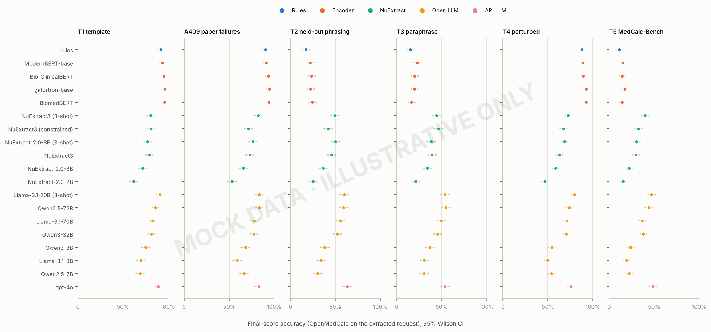

Primary endpoint 1 (plan §8.1). Rows are grouped by system family and sorted by accuracy on the primary sets (T2 ∪ T3). T1 and A409 are reported for comparability only (plan §5.3). Table 3 is the table view.

### Table 3. Primary endpoints (MOCK)

| system | family | T1 | T2∪T3 score | T2∪T3 macro field | T4 | T5 | valid |
|---|---|---|---|---|---|---|---|
| rules | Rules | 0.920 | 0.163 [0.139, 0.190] | 0.649 | 0.878 | 0.113 | 0.863 |
| ModernBERT-base | Encoder | 0.938 | 0.225 [0.197, 0.255] | 0.720 | 0.889 | 0.153 | 0.892 |
| Bio_ClinicalBERT | Encoder | 0.958 | 0.217 [0.190, 0.247] | 0.682 | 0.891 | 0.144 | 0.880 |
| gatortron-base | Encoder | 0.968 | 0.210 [0.183, 0.240] | 0.712 | 0.928 | 0.174 | 0.887 |
| BiomedBERT | Encoder | 0.963 | 0.206 [0.180, 0.236] | 0.686 | 0.926 | 0.142 | 0.873 |
| NuExtract3 (3-shot) | NuExtract | 0.807 | 0.469 [0.434, 0.503] | 0.878 | 0.725 | 0.400 | 0.943 |
| NuExtract3 (constrained) | NuExtract | 0.812 | 0.443 [0.408, 0.477] | 0.872 | 0.672 | 0.325 | 0.953 |
| NuExtract-2.0-8B (3-shot) | NuExtract | 0.775 | 0.441 [0.407, 0.476] | 0.857 | 0.688 | 0.305 | 0.948 |
| NuExtract3 | NuExtract | 0.792 | 0.424 [0.390, 0.458] | 0.842 | 0.630 | 0.298 | 0.930 |
| NuExtract-2.0-8B | NuExtract | 0.720 | 0.351 [0.319, 0.385] | 0.823 | 0.586 | 0.223 | 0.938 |
| NuExtract-2.0-2B | NuExtract | 0.620 | 0.230 [0.202, 0.260] | 0.739 | 0.466 | 0.156 | 0.886 |
| Llama-3.1-70B (3-shot) | Open LLM | 0.910 | 0.568 [0.533, 0.601] | 0.916 | 0.796 | 0.470 | 0.968 |
| Qwen2.5-72B | Open LLM | 0.865 | 0.568 [0.533, 0.601] | 0.913 | 0.737 | 0.440 | 0.966 |
| Llama-3.1-70B | Open LLM | 0.830 | 0.526 [0.492, 0.561] | 0.899 | 0.710 | 0.366 | 0.961 |
| Qwen3-32B | Open LLM | 0.820 | 0.487 [0.453, 0.522] | 0.885 | 0.702 | 0.381 | 0.954 |
| Qwen3-8B | Open LLM | 0.755 | 0.375 [0.342, 0.409] | 0.837 | 0.544 | 0.235 | 0.938 |
| Llama-3.1-8B | Open LLM | 0.698 | 0.324 [0.292, 0.357] | 0.799 | 0.497 | 0.194 | 0.925 |
| Qwen2.5-7B | Open LLM | 0.693 | 0.302 [0.272, 0.335] | 0.806 | 0.539 | 0.223 | 0.931 |
| gpt-4o | API LLM | 0.892 | 0.585 [0.551, 0.619] | 0.916 | 0.756 | 0.485 | 0.969 |

Score = final-score accuracy, OpenMedCalc on the extracted request. Macro field = per-field accuracy averaged within calculator, then across calculators. Valid = schema-valid outputs.

### Figure 3. Generalisation gap: template text vs new wording (MOCK)

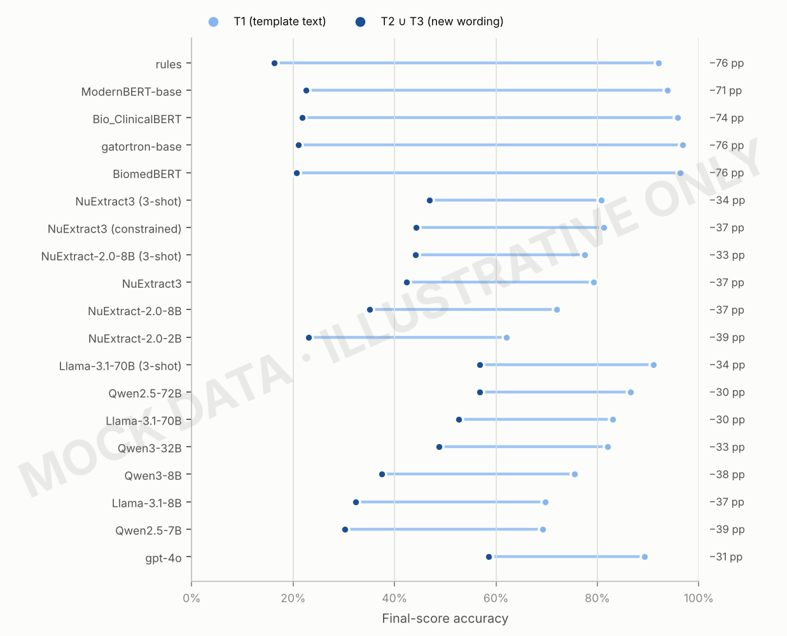

H1/H2 (plan §3). The label is the drop in percentage points from T1 to the primary sets. Systems that memorise phrasings (rules written on T1, fine-tuned encoders) are expected to show the largest drops.

### Table 4. Pairwise comparisons of the best system per family (MOCK)

| comparison | systems | n | only first right | only second right | Δ accuracy | p (exact McNemar) | p (Holm) |
|---|---|---|---|---|---|---|---|
| Rules vs Encoder | rules vs ModernBERT-base | 800 | 91 | 141 | -0.062 | 0.001 | 0.002 |
| Rules vs NuExtract | rules vs NuExtract3 (3-shot) | 800 | 62 | 307 | -0.306 | <0.001 | <0.001 |
| Rules vs Open LLM | rules vs Qwen2.5-72B | 800 | 46 | 370 | -0.405 | <0.001 | <0.001 |
| Rules vs API LLM | rules vs gpt-4o | 800 | 46 | 384 | -0.422 | <0.001 | <0.001 |
| Encoder vs NuExtract | ModernBERT-base vs NuExtract3 (3-shot) | 800 | 74 | 269 | -0.244 | <0.001 | <0.001 |
| Encoder vs Open LLM | ModernBERT-base vs Qwen2.5-72B | 800 | 59 | 333 | -0.343 | <0.001 | <0.001 |
| Encoder vs API LLM | ModernBERT-base vs gpt-4o | 800 | 53 | 341 | -0.360 | <0.001 | <0.001 |
| NuExtract vs Open LLM | NuExtract3 (3-shot) vs Qwen2.5-72B | 800 | 140 | 219 | -0.099 | <0.001 | <0.001 |
| NuExtract vs API LLM | NuExtract3 (3-shot) vs gpt-4o | 800 | 121 | 214 | -0.116 | <0.001 | <0.001 |
| Open LLM vs API LLM | Qwen2.5-72B vs gpt-4o | 800 | 155 | 169 | -0.017 | 0.470 | 0.470 |

Family (i) of the pre-specified comparisons (plan §9), on T2 ∪ T3, paired by case.

## Where systems succeed and fail

### Figure 4. Field accuracy by system and calculator (MOCK)

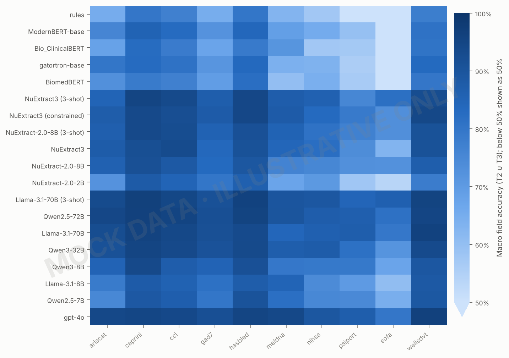

Primary endpoint 2 (plan §8.1), broken down by calculator. Scale starts at 50%. Table 5 gives the per-calculator numbers for the best system of each family.

### Table 5. Final-score accuracy by calculator (best system per family, T2 ∪ T3) (MOCK)

| calculator | n | Rules: rules | Encoder: ModernBERT-base | NuExtract: NuExtract3 (3-shot) | Open LLM: Qwen2.5-72B | API LLM: gpt-4o |
|---|---|---|---|---|---|---|
| ariscat | 80 | 0.200 | 0.338 | 0.600 | 0.775 | 0.800 |
| caprini | 80 | 0.013 | 0.075 | 0.175 | 0.325 | 0.338 |
| cci | 80 | 0.113 | 0.075 | 0.375 | 0.500 | 0.463 |
| gad7 | 80 | 0.175 | 0.225 | 0.388 | 0.575 | 0.562 |
| hasbled | 80 | 0.300 | 0.412 | 0.650 | 0.725 | 0.725 |
| meldna | 80 | 0.300 | 0.463 | 0.738 | 0.812 | 0.812 |
| nihss | 80 | 0.087 | 0.087 | 0.250 | 0.225 | 0.300 |
| psiport | 80 | 0.050 | 0.075 | 0.312 | 0.450 | 0.475 |
| sofa | 80 | 0.150 | 0.250 | 0.625 | 0.700 | 0.675 |
| wellsdvt | 80 | 0.237 | 0.250 | 0.575 | 0.588 | 0.700 |

Per-calculator n is about 200 per system, so these rows are descriptive (plan §9).

### Figure 5. Accuracy by field type (MOCK)

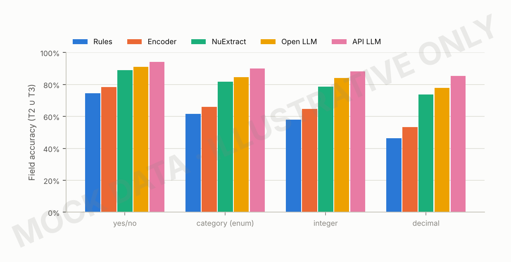

Secondary endpoint (plan §8.2). Enum fields include ordinal scales (NIHSS, GAD-7), where off-by-one readings are the expected error.

### Figure 6. Documented vs undocumented criteria (T5) (MOCK)

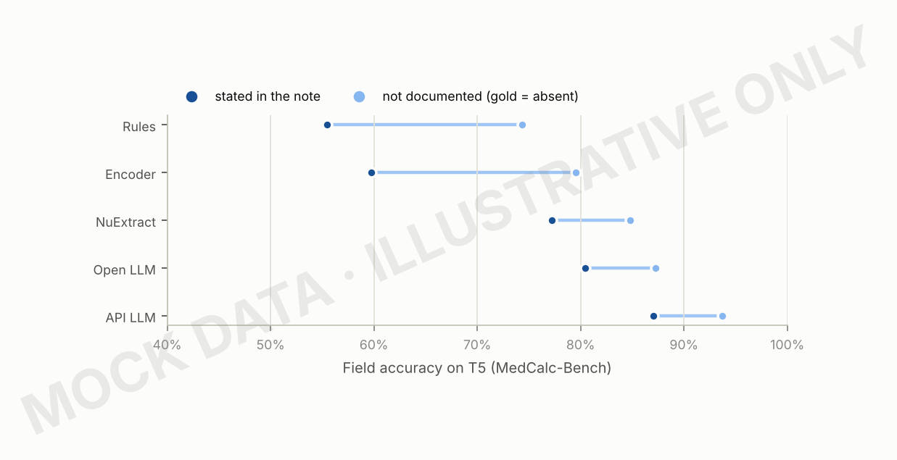

Plan §8.3. Undocumented criteria test whether a system invents findings (hallucinated presence). Axis starts at 40%.

### Table 6. Clinical agreement: risk bands, all-fields rate, score error (MOCK)

| system | score accuracy | risk-band agreement | all fields correct | mean |score error| |
|---|---|---|---|---|
| rules | 0.163 | 0.634 | 0.066 | 5.164 |
| ModernBERT-base | 0.225 | 0.714 | 0.117 | 4.999 |
| Bio_ClinicalBERT | 0.217 | 0.682 | 0.105 | 5.422 |
| gatortron-base | 0.210 | 0.676 | 0.107 | 4.765 |
| BiomedBERT | 0.206 | 0.672 | 0.090 | 5.003 |
| NuExtract3 (3-shot) | 0.469 | 0.820 | 0.405 | 2.255 |
| NuExtract3 (constrained) | 0.443 | 0.838 | 0.359 | 3.026 |
| NuExtract-2.0-8B (3-shot) | 0.441 | 0.819 | 0.339 | 3.017 |
| NuExtract3 | 0.424 | 0.782 | 0.326 | 2.606 |
| NuExtract-2.0-8B | 0.351 | 0.779 | 0.224 | 3.424 |
| NuExtract-2.0-2B | 0.230 | 0.715 | 0.136 | 4.379 |
| Llama-3.1-70B (3-shot) | 0.568 | 0.871 | 0.496 | 1.886 |
| Qwen2.5-72B | 0.568 | 0.881 | 0.492 | 1.836 |
| Llama-3.1-70B | 0.526 | 0.853 | 0.440 | 2.533 |
| Qwen3-32B | 0.487 | 0.829 | 0.399 | 2.359 |
| Qwen3-8B | 0.375 | 0.787 | 0.271 | 3.044 |
| Llama-3.1-8B | 0.324 | 0.755 | 0.212 | 3.819 |
| Qwen2.5-7B | 0.302 | 0.757 | 0.198 | 3.679 |
| gpt-4o | 0.585 | 0.873 | 0.500 | 1.734 |

Risk bands are provisional (`evaluate.RISK_BANDS`) until a clinician signs off the cut-offs. The gap between all-fields-correct and score accuracy measures how often errors cancel out.

## Robustness, schema design and the original study

### Figure 7. Robustness to controlled perturbations (T4) (MOCK)

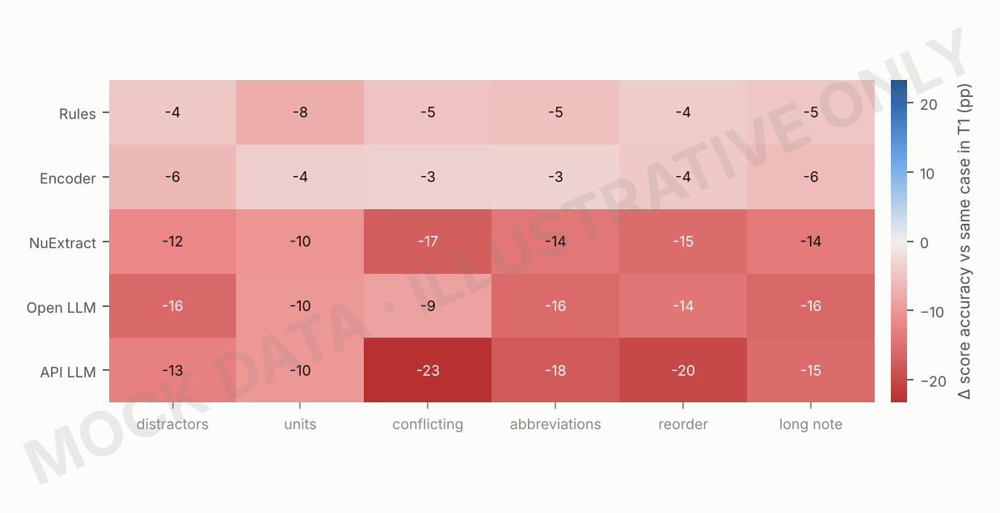

RQ4. Each cell is the paired change in final-score accuracy, T4 minus the same base case in T1, averaged over the systems in a family. Red is worse than on the original text.

### Figure 8. Decision vs raw-facts schema (HAS-BLED) (MOCK)

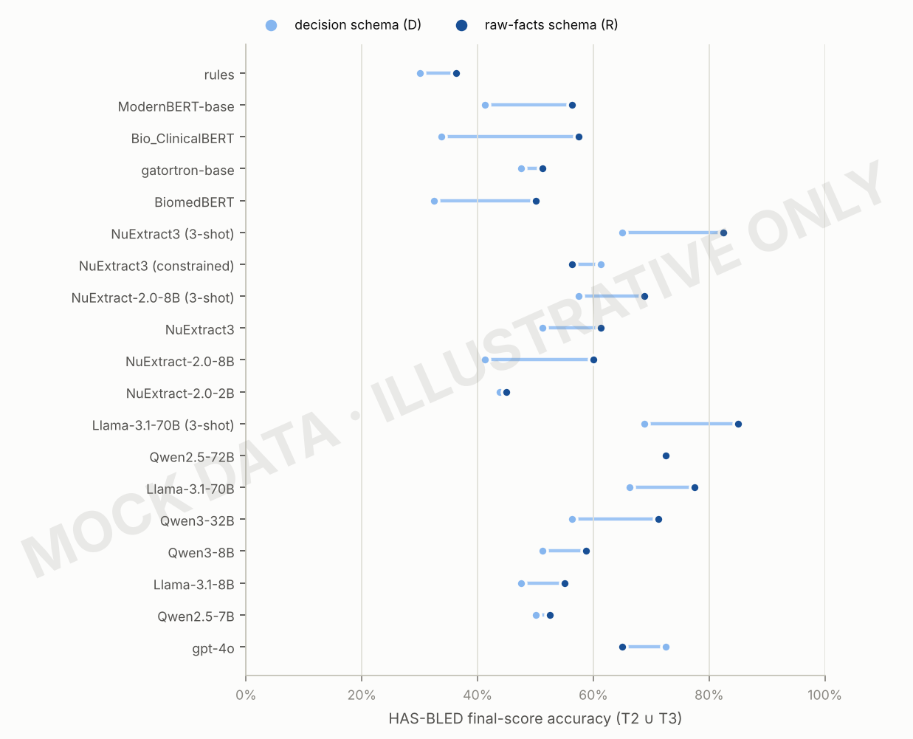

RQ3/H4. Same notes, two schemas: the extractor applies the thresholds (D) or the API does (R).

### Figure 9. Extract-then-compute vs the paper's end-to-end arms (MOCK)

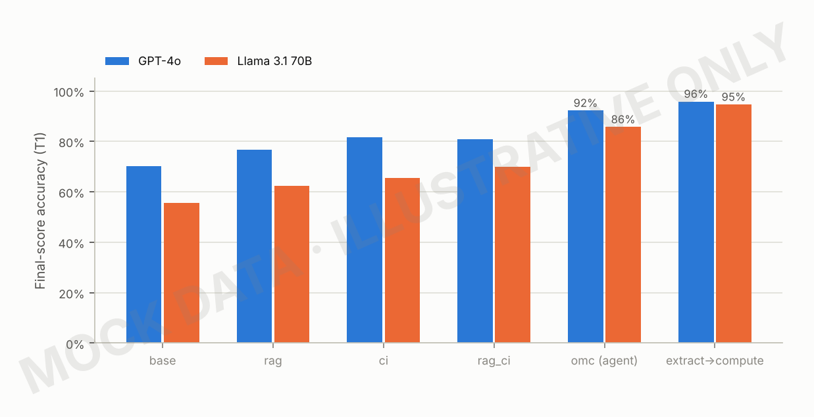

RQ2/H3. The first five arms are the original study's (re-run on the same T1 cases); the last is this benchmark's pipeline with the same model. Only T1 allows the original arms' parser to be reused.

### Table 7. Paper arms vs extract-then-compute (T1) (MOCK)

| arm | GPT-4o | Llama 3.1 70B |
|---|---|---|
| base | 0.703 | 0.556 |
| rag | 0.766 | 0.623 |
| ci | 0.816 | 0.655 |
| rag_ci | 0.808 | 0.698 |
| omc (agent) | 0.922 | 0.857 |
| extract→compute | 0.958 | 0.946 |

Table view of Figure 9.

## Errors, cost and the statistical model

### Figure 10. What kind of mistakes each family makes (MOCK)

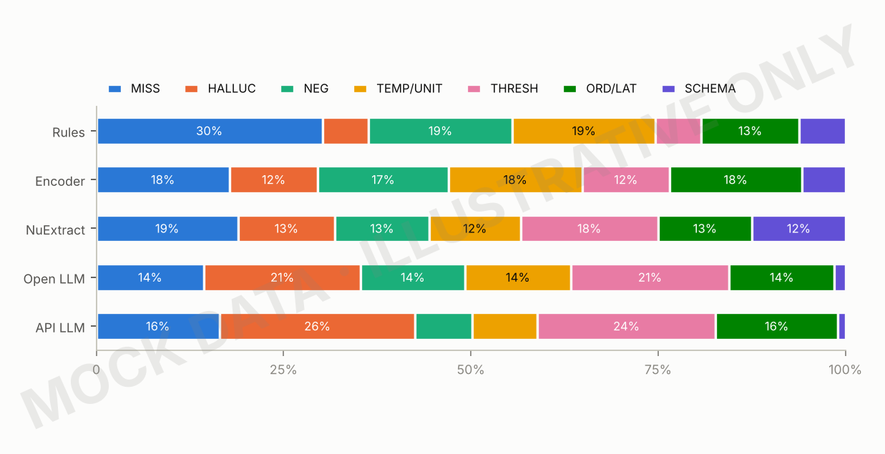

Plan §10. Share of annotated field errors by code: missed fact, hallucinated value, negation, time point or unit, threshold applied wrongly, ordinal or laterality slip, schema failure. Real values need the two-annotator error study.

### Table 8. Error codes by family (share of annotated field errors) (MOCK)

| family | MISS | HALLUC | NEG | TEMP/UNIT | THRESH | ORD/LAT | SCHEMA |
|---|---|---|---|---|---|---|---|
| Rules | 0.302 | 0.061 | 0.192 | 0.191 | 0.061 | 0.131 | 0.062 |
| Encoder | 0.178 | 0.118 | 0.174 | 0.179 | 0.117 | 0.176 | 0.058 |
| NuExtract | 0.189 | 0.129 | 0.126 | 0.122 | 0.183 | 0.126 | 0.125 |
| Open LLM | 0.144 | 0.209 | 0.139 | 0.142 | 0.211 | 0.141 | 0.015 |
| API LLM | 0.164 | 0.261 | 0.076 | 0.087 | 0.238 | 0.163 | 0.010 |

Table view of Figure 10.

### Figure 11. Accuracy against speed and deployment (MOCK)

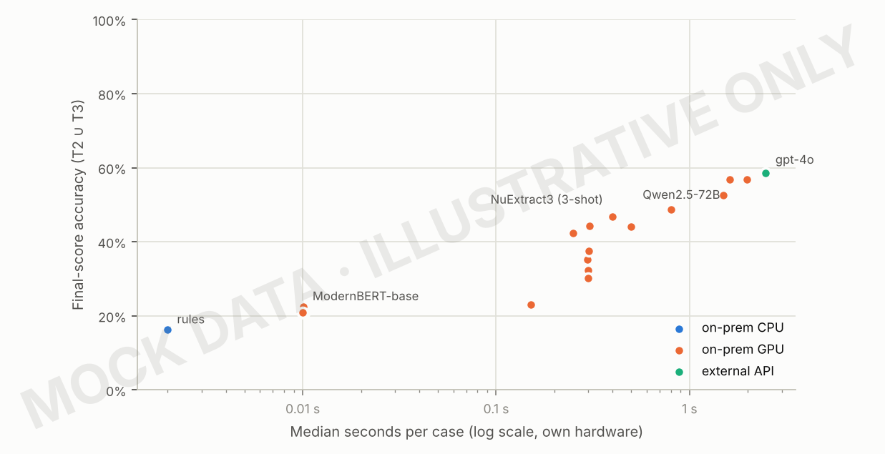

RQ5. Colour is where the system can run; this matters for patient data. The best system of each family is labelled. Table 9 adds GPU-hours.

### Table 9. Operational metrics (MOCK)

| system | median s/case | p95 s/case | deployment | GPU-hours per 1k cases |
|---|---|---|---|---|
| rules | 0.002 | 0.002 | on-prem CPU | — |
| ModernBERT-base | 0.010 | 0.012 | on-prem GPU | 0.003 |
| Bio_ClinicalBERT | 0.010 | 0.012 | on-prem GPU | 0.003 |
| gatortron-base | 0.010 | 0.012 | on-prem GPU | 0.003 |
| BiomedBERT | 0.010 | 0.012 | on-prem GPU | 0.003 |
| NuExtract3 (3-shot) | 0.400 | 0.472 | on-prem GPU | 0.111 |
| NuExtract3 (constrained) | 0.301 | 0.354 | on-prem GPU | 0.083 |
| NuExtract-2.0-8B (3-shot) | 0.500 | 0.589 | on-prem GPU | 0.139 |
| NuExtract3 | 0.249 | 0.295 | on-prem GPU | 0.069 |
| NuExtract-2.0-8B | 0.300 | 0.353 | on-prem GPU | 0.083 |
| NuExtract-2.0-2B | 0.150 | 0.177 | on-prem GPU | 0.042 |
| Llama-3.1-70B (3-shot) | 1.993 | 2.357 | on-prem GPU | 0.554 |
| Qwen2.5-72B | 1.603 | 1.889 | on-prem GPU | 0.445 |
| Llama-3.1-70B | 1.497 | 1.770 | on-prem GPU | 0.416 |
| Qwen3-32B | 0.802 | 0.943 | on-prem GPU | 0.223 |
| Qwen3-8B | 0.300 | 0.353 | on-prem GPU | 0.083 |
| Llama-3.1-8B | 0.300 | 0.354 | on-prem GPU | 0.083 |
| Qwen2.5-7B | 0.299 | 0.354 | on-prem GPU | 0.083 |
| gpt-4o | 2.494 | 2.955 | external API | — |

Plan §8.4. Real latency comes from `latency_s` in each prediction; GPU-hours scale it by the GPUs in `models.tsv`; API cost is added from the provider's invoice.

### Table 10. Mixed-effects logistic model of field correctness (SHELL)

| term | log-odds [95% CI] | odds ratio | p |
|---|---|---|---|
| (Intercept) | — | — | — |
| system [each vs rules] | — | — | — |
| schema variant R | — | — | — |
| field type: enum | — | — | — |
| field type: int | — | — | — |
| field type: float | — | — | — |
| test set: T2 | — | — | — |
| test set: T3 | — | — | — |
| test set: T4 | — | — | — |
| test set: T5 | — | — | — |
| system × test set (one row per pair) | — | — | — |
| random intercept SD: calculator | — | — | — |
| random intercept SD: case | — | — | — |
| random intercept SD: field | — | — | — |

Plan §9: correct ~ system + schema_variant + field_type + test_set + system:test_set + (1|calculator) + (1|case) + (1|field). Fitted on real field-level rows only; no mock values.

## Real results already available

### Figure 12. Can a final-score error be traced to one field? (REAL)

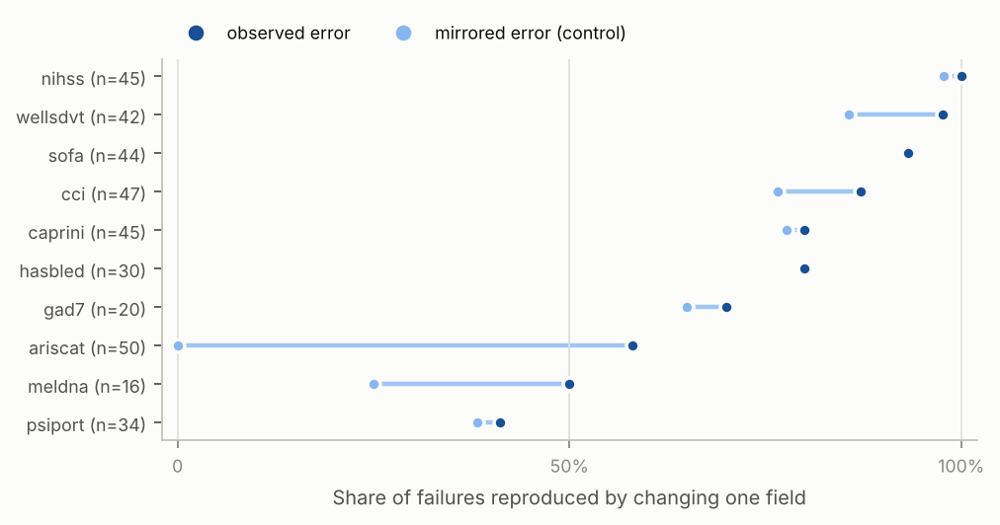

Real data: the 373 Abacus-409 failures with a numeric answer. Where the control is as high as the observed share (additive scores), a one-field explanation is no evidence of which field was misread.

### Figure 13. CPU baselines across test sets (REAL)

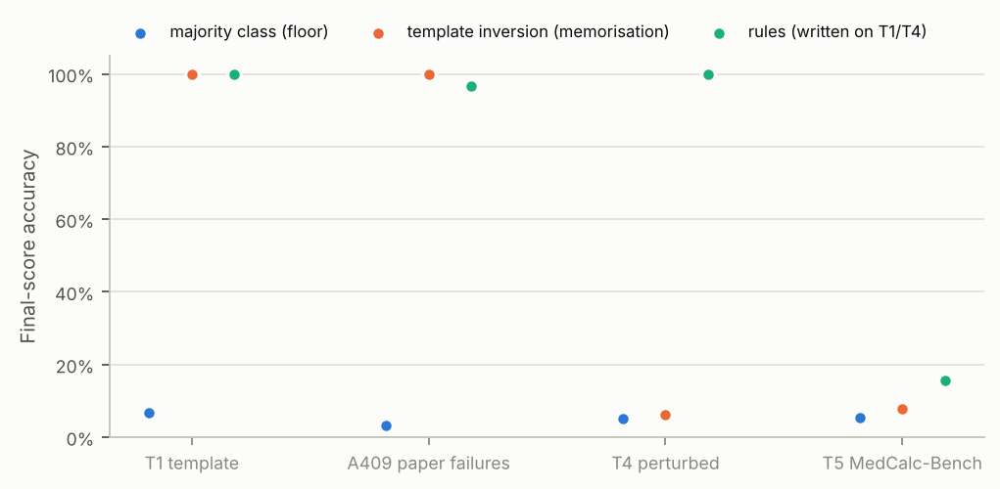

Real data. Perfect scores on template text (T1, A409) fall to the floor once the wording is new: the reason T2, T3 and T5 are primary.
